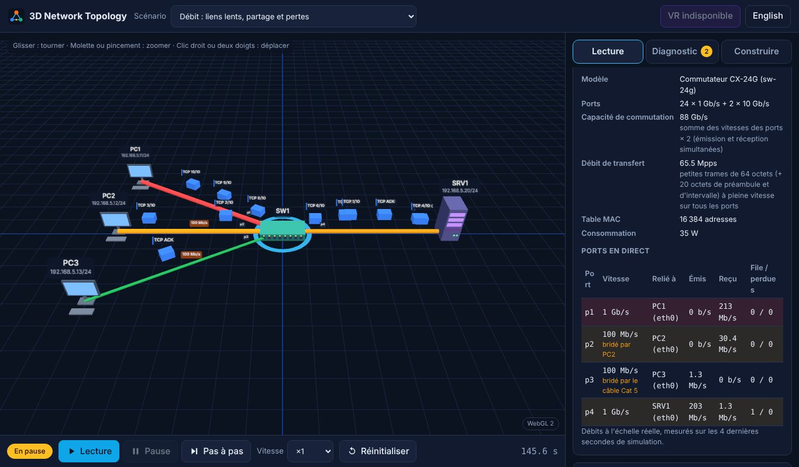
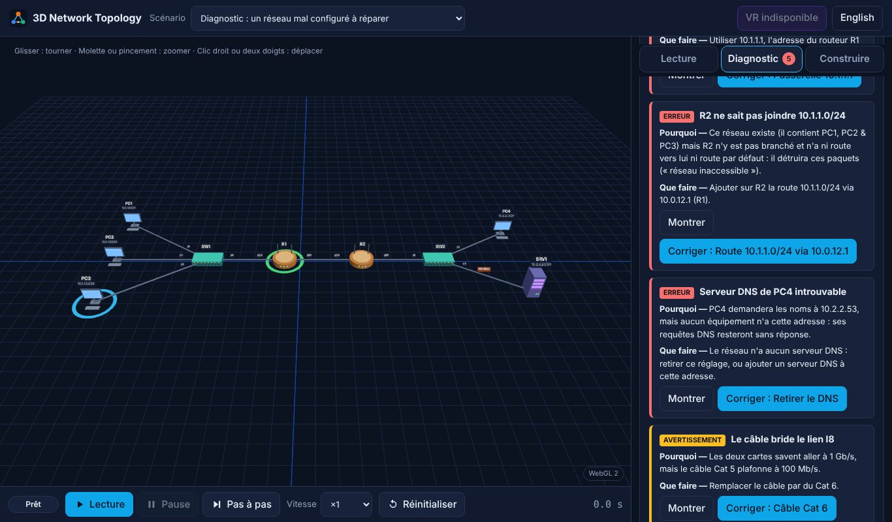

# 3D Network Topology

Comprendre les protocoles réseau en regardant leurs messages circuler dans une topologie 3D interactive.
Application pédagogique pour les étudiants du cycle ingénieur — projet WebXR & Spatial Computing, SUP'COM, département SIA.

**▶ Ouvrir l'application : `https://<compte>.github.io/<depot>/`** *(remplacer par l'adresse GitHub Pages du dépôt)*

Rien à installer : un navigateur récent suffit, sur PC ou sur smartphone.

## Ce que fait l'application

- **Rendu WebGPU partout, VR comprise** (Three.js `WebGPURenderer`), avec secours WebGL 2 automatique.
- **Topologie 3D** de PC, serveurs, switches et routeurs, à explorer à la souris ou au doigt.
- **Scénarios animés** : ARP, ICMP (ping), DHCP, UDP, DNS, TCP, HTTP, IPv6, routage statique, traceroute, débit, diagnostic.
- **Explication de chaque message**, en français ou en anglais.
- **Commandes** : lecture, pause, pas à pas, vitesse, réinitialisation.
- **Inspecteur de paquet** : adresses MAC et IP, TTL, ports, indicateurs TCP, contenu.
- **Ping à la demande** entre deux hôtes choisis dans la scène.
- **PWA** : installation facultative, fonctionnement hors ligne après une première visite.
- **Mode VR** par WebXR, utilisable sans casque avec l'extension Immersive Web Emulator, avec panneaux 3D de commandes, d'explications, de fiche technique et de diagnostic.
- **Débit** : vitesse négociée de chaque lien, temps d'émission des trames, files d'attente, pertes, transferts TCP à fenêtre glissante avec retransmissions ; câbles colorés selon leur charge ; fiche technique des équipements.
- **Diagnostic** : adresses, passerelles, routes, câblage et performances vérifiés, avec la cause, le conseil et une correction en un clic.
- **Éditeur** : construire sa propre topologie (ajout, glisser-déposer, câblage, réglages, adressage automatique), l'enregistrer, l'exporter en JSON, annuler / rétablir.
- **Laboratoire** : entrer dans une salle à la première personne (ou en VR à l'échelle réelle), viser un équipement et ouvrir sa **console** ; chaque modèle a sa fiche et son style de commandes (IOS, VRP, invite de commandes) ; VLAN, sécurité de port, ACL, NAT et pare-feu à états ; clavier 3D et téléportation en VR ; six **missions** guidées vérifiées automatiquement.

| Débit et fiche technique | Diagnostic | Éditeur |
| --- | --- | --- |
|  |  |  |

## Lancer en local

Prérequis : [Node.js](https://nodejs.org) 20 ou plus récent. Aucune dépendance à installer.

```bash
git clone https://github.com/<compte>/<depot>.git
cd <depot>
npm start        # puis ouvrir http://localhost:8080
npm test         # tests automatiques
```

Ouvrir `index.html` par un double-clic ne fonctionne pas (les modules JavaScript exigent un serveur) : passer par `npm start`.

## Documentation

| Document | Contenu |
| --- | --- |
| [Manuel utilisateur](docs/manuel.md) | navigation, ping, inspection, installation, VR, dépannage |
| [Cahier conceptuel](docs/cahier-conceptuel.md) | besoins et diagrammes : cas d'utilisation, séquence du ping, classes, déploiement |
| [Architecture](docs/architecture.md) | organisation du code et choix techniques |
| [Lancement et déploiement](docs/lancement-deploiement.md) | serveur local, GitHub Pages, publication d'une version |
| [Simulation](docs/simulation.md) · [Rendu 3D](docs/rendu-3d.md) | fonctionnement détaillé des deux moteurs |
| [Contrats communs](docs/contrats.md) · [Format des scénarios](docs/format-scenario.md) · [API de rendu](docs/api-rendu.md) | interfaces entre les parties |
| [Protocoles](docs/protocoles/) | une page par protocole, avec ses simplifications pédagogiques |
| [Débit](docs/debit.md) · [Diagnostic](docs/diagnostic.md) · [Éditeur](docs/editeur.md) · [VR en WebGPU](docs/vr-webgpu.md) · [Laboratoire](docs/laboratoire.md) · [Consoles](docs/console.md) | compléments demandés par le superviseur (S5 à S7) |
| [Origine des ressources](ATTRIBUTION.md) | bibliothèques, modèles, données et aides extérieures |

## Organisation du dépôt

```
index.html, styles.css     page et style
main.js                    assemble les quatre parties
simulation.js, src/sim/    moteur de simulation, équipements, protocoles
src/render/                scène 3D (Three.js, WebGPURenderer)
src/ui/                    interface
src/xr/                    mode VR (WebXR)
scenarios/                 scénarios JSON
assets/                    modèles GLB, icônes
vendor/three/              Three.js r187 (version figée)
manifest.json, sw.js       PWA
tests/                     tests automatiques
tools/                     serveur local et scripts de génération
docs/                      documentation
```

## Ajouter un scénario

1. Écrire `scenarios/mon-scenario.json` en suivant le [format](docs/format-scenario.md).
2. L'ajouter à `scenarios/index.json`.
3. `npm test` vérifie qu'il est valide ; `UPDATE_GOLDEN=1 node --test tests/regression.test.js` enregistre sa trace de référence.

## Règles de contribution

- Chacun ne modifie que ses fichiers (`.github/CODEOWNERS`). Un bug chez un autre = une issue assignée à son propriétaire.
- Les contrats communs (`src/sim/events.js`, le format des scénarios, `index.html`) ne changent que par une pull request approuvée par les quatre.
- Push quotidien sur sa branche `feature/<membre>-<sujet>` ; fusion dans `main` le mercredi et le dimanche, après `git pull --rebase origin main`.
- `main` reste toujours exécutable : les tests passent avant toute fusion.

## Équipe

| Membre | Responsabilités |
| --- | --- |
| Rami Driouech | interface, page et style, DHCP, HTTP, manuel |
| Mohamed Aziz Saoudi | rendu 3D, modèles, ICMP, UDP, DNS |
| Khalil Krifa | moteur de simulation, contrats, hôte et routeur, ARP, TCP, routage |
| Ayoub Ben Sabbeh | démarrage, PWA, CI et déploiement, mode VR, animation des paquets, switch |

Superviseur : Dr. Eng. Mohamed Becha Kaaniche.

## Licence

Code sous licence MIT (voir `LICENSE`). Three.js : licence MIT (`vendor/three/LICENSE`).
