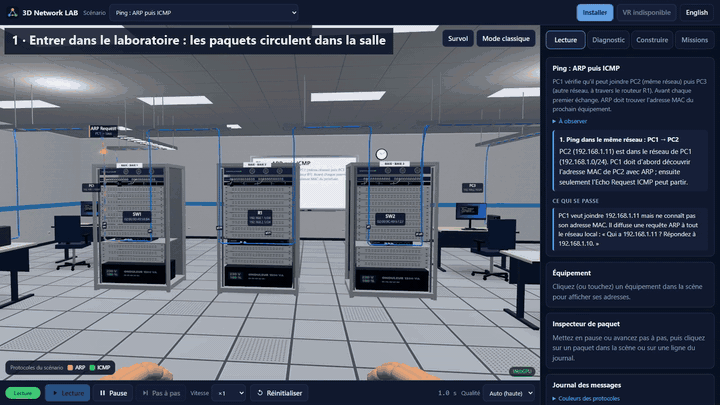
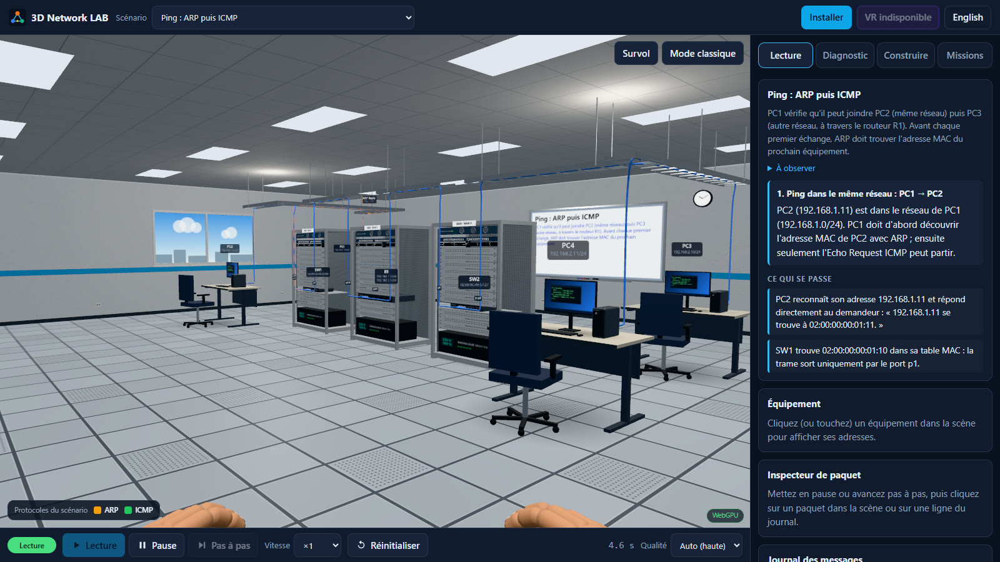
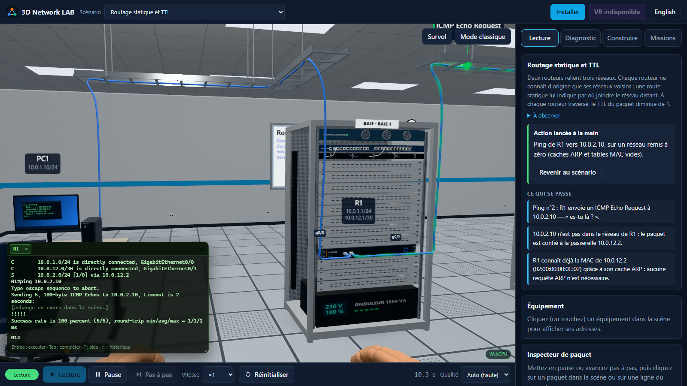
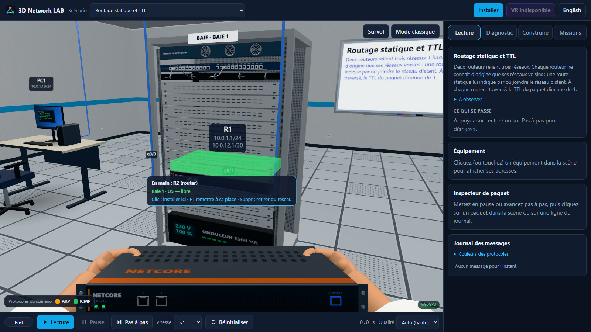
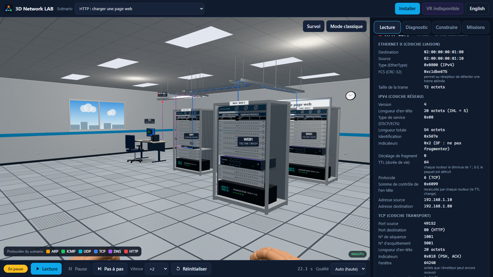
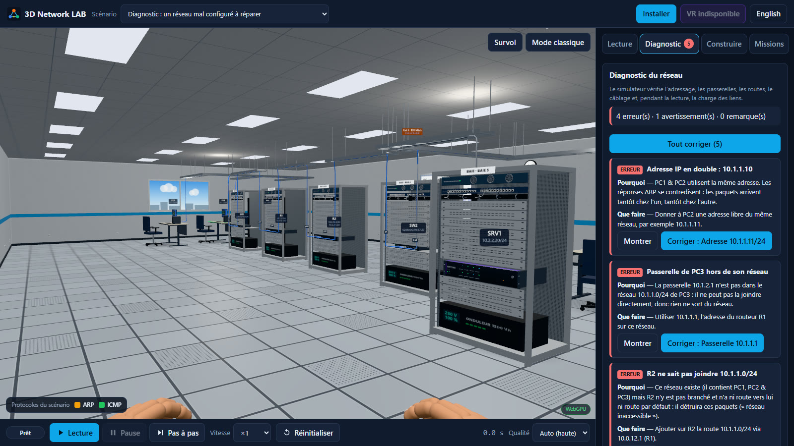
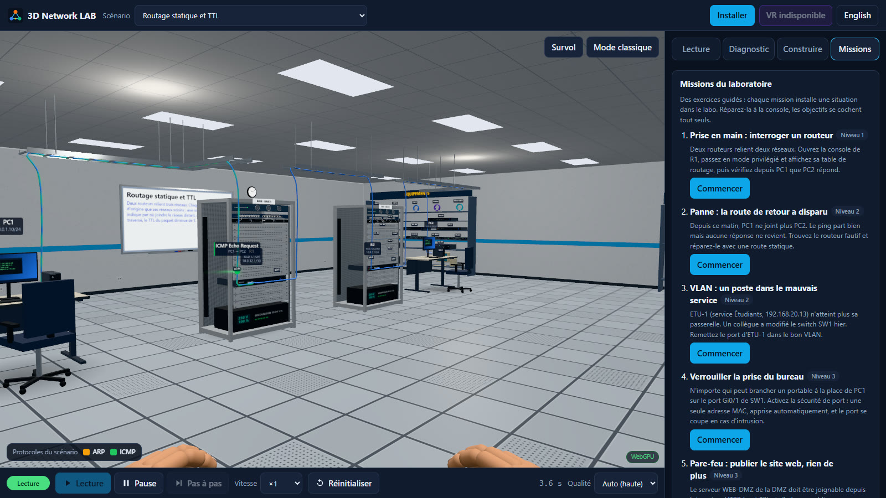
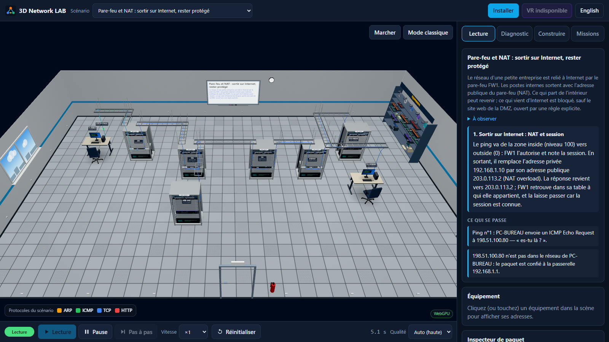
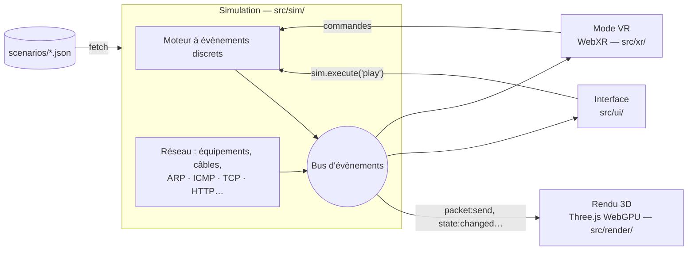

<div align="center">


# 3D Network LAB

**Un laboratoire réseau en 3D, dans le navigateur.**<br>
Entrez dans une salle réseau, configurez routeurs et switchs en console, câblez à la main,<br>
et regardez chaque trame ARP, ICMP, TCP ou HTTP circuler — expliquée pas à pas.

[](https://github.com/ramydriwech/3D-Network-LAB/actions/workflows/ci.yml)


**[▶ Ouvrir l'application](https://ramydriwech.github.io/3D-Network-LAB/)** ·
**[🎬 Vidéo de démonstration](docs/media/demo.mp4)** ·
**[📖 Manuel](docs/manuel.md)** ·
**[🏗️ Architecture](docs/architecture.md)**

<br>



<sub>Démo de 14 s — la version complète (30 s, 1280 × 720) est dans <a href="docs/media/demo.mp4"><code>docs/media/demo.mp4</code></a>.</sub>

</div>

---

## Pourquoi ce projet

Les schémas statiques expliquent mal ce qui se passe vraiment sur un réseau : qui parle à qui, dans quel ordre,
pourquoi un routeur réécrit les adresses MAC mais garde les adresses IP, pourquoi un ping échoue. Les simulateurs
professionnels, eux, demandent une installation et une prise en main qui freinent la découverte.

**3D Network LAB** comble cet écart : une application web, sans installation, qui ouvre directement sur un
**laboratoire en 3D**. On y circule à la première personne, on configure les équipements avec de vraies commandes,
et **chaque message est animé dans la salle puis expliqué** — en français ou en anglais.

<table>
<tr>
<td align="center"><b>16</b><br><sub>scénarios guidés</sub></td>
<td align="center"><b>8</b><br><sub>protocoles simulés</sub></td>
<td align="center"><b>14</b><br><sub>modèles d'équipements</sub></td>
<td align="center"><b>6</b><br><sub>missions auto-corrigées</sub></td>
<td align="center"><b>208</b><br><sub>tests automatiques</sub></td>
<td align="center"><b>0</b><br><sub>dépendance npm</sub></td>
</tr>
</table>

## Visite guidée

<table>
<tr>
<td width="50%">

<p align="center"><b>Le laboratoire</b><br><sub>Baies 19 pouces, postes de travail, chemins de câbles au plafond : le réseau du scénario est monté dans une vraie salle, où l'on circule librement.</sub></p>
</td>
<td width="50%">

<p align="center"><b>Une console par équipement</b><br><sub><code>show ip route</code>, <code>ping</code>, <code>vlan</code>, <code>access-list</code>… Le réseau change vraiment, et les paquets du ping traversent la baie sous vos yeux.</sub></p>
</td>
</tr>
<tr>
<td width="50%">

<p align="center"><b>Construire à la main</b><br><sub>Poser les meubles, installer chaque équipement dans le bon emplacement U, brancher les câbles prise par prise. Chaque geste s'annule.</sub></p>
</td>
<td width="50%">

<p align="center"><b>Inspecteur de trame</b><br><sub>Chaque paquet se décode comme dans un analyseur réseau : Ethernet, IPv4, TCP, HTTP, sommes de contrôle et octets bruts, calculés sur la trame reconstruite.</sub></p>
</td>
</tr>
<tr>
<td width="50%">

<p align="center"><b>Diagnostic</b><br><sub>Adresses en double, passerelles erronées, routes manquantes, liens saturés : chaque problème vient avec sa cause, un conseil et une correction en un clic.</sub></p>
</td>
<td width="50%">

<p align="center"><b>Missions guidées</b><br><sub>Six exercices, de la prise en main au réseau construit de zéro. Les objectifs se valident tout seuls, quelle que soit la méthode utilisée.</sub></p>
</td>
</tr>
</table>

<p align="center">
<br>
<sub><b>Vue de survol</b> — le scénario « Pare-feu et NAT » : réseau interne, DMZ, pare-feu à états et Internet, dans la même salle.</sub>
</p>

## Fonctionnalités

### 🧪 Le laboratoire
- **Salle à la première personne** (ZQSD / WASD + souris, joystick tactile sur mobile), vue de **survol**, et **mode classique** pour voir la topologie logique d'un coup d'œil (touche **L**).
- **Construction à la main** : baies 12U et 6U, postes de travail, tables ; installation dans un emplacement U précis ; câbles Cat 5 à fibre OM3 branchés prise par prise. Tout est annulable et s'exporte en JSON.
- **Consoles par modèle**, avec trois styles de commandes : **IOS** (NetCore OS), **VRP** (Versa NOS) et **invite de commandes** pour les PC (`ipconfig`, `ping`, `tracert`).
- **Fonctions avancées** : VLAN 802.1Q et trunks, router-on-a-stick, sécurité de port (sticky, *err-disabled*), ACL étendues, NAT/PAT, pare-feu à états avec zones de sécurité.

### 📡 La simulation
- **Moteur à évènements discrets** déterministe : la même suite d'actions donne toujours la même suite de trames, indépendamment du nombre d'images par seconde.
- **Protocoles** : ARP, ICMP, UDP, DNS, DHCP, TCP (fenêtre glissante, ACK dupliqués, retransmission rapide), HTTP, IPv6 (découverte de voisins), routage statique et TTL.
- **Trames reconstruites octet par octet** : longueurs, sommes de contrôle Internet et CRC-32 Ethernet réels.
- **Débit** : vitesse négociée de chaque lien, temps d'émission, files d'attente, pertes ; câbles colorés selon leur charge.

### 🎓 La pédagogie
- **Lecture, pause, pas à pas, vitesse de ×0,25 à ×4** : chaque trame est expliquée au moment où elle part.
- **Journal des messages** et **tables vivantes** : cache ARP, table MAC, table de routage, connexions TCP.
- **Ping à la demande** entre deux machines choisies dans la scène.
- **Bilingue** français / anglais, textes portés par les protocoles et les scénarios.

### 🥽 VR et PWA
- **Mode VR WebXR** à l'échelle réelle : téléportation, rotation par crans, clavier 3D pour les consoles, panneaux 3D. Utilisable sans casque avec l'extension *Immersive Web Emulator*.
- **Application installable** (PWA) qui fonctionne **hors ligne** après une première visite.

## Sous le capot

Un site **100 % statique** : HTML, CSS, modules ES natifs et JSON. Pas de compilation, pas de serveur applicatif,
pas de dépendance à l'exécution — le dépôt *est* le site. Quatre modules indépendants communiquent uniquement par
trois contrats : un **bus d'évènements**, des **commandes** et une **API de rendu**.



| Choix | Pourquoi |
| --- | --- |
| **WebGPU uniquement**, VR comprise (pont WebXR maison) | rendu moderne, éclairage et ombres de qualité, même moteur à l'écran et dans le casque |
| **Simulation séparée du rendu** | scénarios testables sans navigateur ; traces de référence comparées à chaque test |
| **Scénarios en JSON** | un enseignant peut écrire un exercice sans programmer |
| **Diagnostic et éditeur en fonctions pures** | testables ; annuler = revenir à la version précédente du scénario |
| **Three.js figé dans `vendor/`**, chemins relatifs | aucun CDN, fonctionnement hors ligne garanti, déploiement sous n'importe quel chemin |

Détails : [architecture](docs/architecture.md) · [simulation](docs/simulation.md) · [rendu 3D](docs/rendu-3d.md) · [VR en WebGPU](docs/vr-webgpu.md).

## Démarrer

**En ligne** : ouvrez **[l'application](https://ramydriwech.github.io/3D-Network-LAB/)** dans un navigateur
compatible WebGPU (Chrome, Edge, Safari 26+, Firefox 141+ sous Windows). Rien à installer.

**En local** — seul [Node.js](https://nodejs.org) 20+ est nécessaire :

```bash
git clone https://github.com/ramydriwech/3D-Network-LAB.git
cd 3D-Network-LAB
npm start        # http://localhost:8080
npm test         # 208 tests (node --test)
```

> Un double-clic sur `index.html` ne suffit pas : les modules JavaScript exigent un serveur, d'où `npm start`.

Raccourcis utiles : **Espace** lecture / pause · **→** pas à pas · **E** console · **F** prendre / reposer ·
**V** survol · **L** mode classique.

## Documentation

| | |
| --- | --- |
| **Utiliser** | [Manuel utilisateur](docs/manuel.md) · [Laboratoire](docs/laboratoire.md) · [Consoles et commandes](docs/console.md) |
| **Comprendre** | [Cahier conceptuel](docs/cahier-conceptuel.md) · [Architecture](docs/architecture.md) · [Simulation](docs/simulation.md) · [Rendu 3D](docs/rendu-3d.md) |
| **Protocoles** | [ARP](docs/protocoles/arp.md) · [ICMP](docs/protocoles/icmp.md) · [UDP](docs/protocoles/udp.md) · [DNS](docs/protocoles/dns.md) · [DHCP](docs/protocoles/dhcp.md) · [TCP](docs/protocoles/tcp.md) · [HTTP](docs/protocoles/http.md) · [IPv6](docs/protocoles/ipv6.md) · [Routage](docs/protocoles/routage.md) |
| **Approfondir** | [Débit](docs/debit.md) · [Diagnostic](docs/diagnostic.md) · [Éditeur](docs/editeur.md) · [VR en WebGPU](docs/vr-webgpu.md) |
| **Étendre** | [Format des scénarios](docs/format-scenario.md) · [Contrats d'interface](docs/contrats.md) · [API de rendu](docs/api-rendu.md) · [Lancement et déploiement](docs/lancement-deploiement.md) |

### Ajouter un scénario

1. Écrire `scenarios/mon-scenario.json` en suivant le [format](docs/format-scenario.md).
2. L'ajouter à `scenarios/index.json`.
3. `npm test` le valide ; `UPDATE_GOLDEN=1 node --test tests/regression.test.mjs` enregistre sa trace de référence.

<details>
<summary><b>Organisation du dépôt</b></summary>

```
index.html, styles.css      page et style
main.mjs                    assemble les quatre modules
simulation.mjs, src/sim/    moteur de simulation, équipements, protocoles, consoles, missions
src/render/                 scène 3D et laboratoire (Three.js, WebGPURenderer)
src/ui/                     interface
src/xr/                     mode VR (WebXR)
scenarios/                  scénarios JSON
assets/                     modèles GLB, icônes
vendor/three/               Three.js r187 (version figée)
manifest.json, sw.mjs       PWA
tests/                      tests automatiques et traces de référence
tools/                      serveur local et scripts de génération
docs/                       documentation, captures et démo
```

</details>

## English summary

**3D Network LAB** is a browser-based 3D network lab for learning protocols. Walk through a server room in
first person (or in VR), configure routers and switches from IOS- or VRP-style consoles, cable devices by hand, and
watch every ARP, ICMP, TCP or HTTP frame travel through the room with a step-by-step explanation. It runs entirely
client-side (WebGPU, WebXR, PWA, zero npm dependencies) and the whole interface is available in English.

## Auteur

**Rami Driouech** — conception et développement.<br>
Projet WebXR & Spatial Computing, SUP'COM (département SIA), sous la supervision du Dr. Eng. Mohamed Becha Kaaniche.

## Licence

Code sous licence [MIT](LICENSE). Three.js : licence MIT ([`vendor/three/LICENSE`](vendor/three/LICENSE)).
Origine de chaque ressource : [ATTRIBUTION.md](ATTRIBUTION.md).
