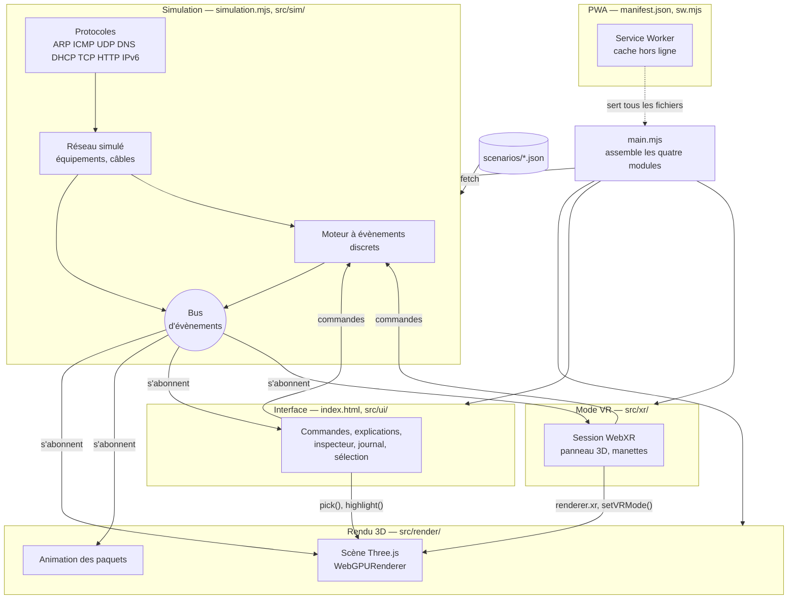

# Architecture générale

3D Network Topology est une **application web statique** : des fichiers HTML, CSS, JavaScript et JSON servis par
GitHub Pages. Tout s'exécute dans le navigateur ; il n'y a ni serveur applicatif ni base de données.

## Vue d'ensemble



## Principe directeur : quatre modules, trois contrats

Pour rester indépendants, testables séparément et faciles à faire évoluer, les quatre modules ne se connaissent
qu'à travers trois contrats ([contrats.md](contrats.md)) :

1. **le bus d'évènements** — la simulation publie ce qui se passe (`packet:send`, `state:changed`…), les autres s'abonnent ;
2. **les commandes** — l'interface et le panneau VR agissent sur la simulation uniquement par `sim.execute('play')` ;
3. **l'API de rendu** — l'interface et la VR utilisent la scène uniquement par les fonctions listées dans `src/render/api.mjs`.

`main.mjs` est le seul fichier qui voit tous les modules. Il se contente de les assembler :

```js
const sim = createSimulation();                       // simulation
const render = await initRender({ container, sim });  // rendu 3D
initUI(app);                                          // interface
initXR(app);                                          // mode VR
await app.loadScenario(catalog.default);
render.start((dtMs) => sim.tick(dtMs));
```

## Ce qui se passe à chaque image

1. Le rendu appelle `sim.tick(dt)` avec le temps réel écoulé.
2. Le moteur avance l'horloge simulée de `dt × vitesse` et exécute les évènements échus ; chacun publie sur le bus.
3. Les abonnés réagissent : l'animateur crée ou retire des paquets, le journal ajoute une ligne, les explications changent.
4. L'animateur place chaque paquet d'après `sim.now` (et non d'après le nombre d'images).
5. Three.js dessine la scène.

En pause, l'étape 2 ne fait rien : les paquets restent figés, mais la caméra continue de tourner librement.

## Organisation du dépôt

| Chemin | Contenu |
| --- | --- |
| `index.html`, `styles.css` | page, zones réservées, style |
| `main.mjs` | assemblage |
| `simulation.mjs`, `src/sim/` | moteur, réseau, contrats, équipements, protocoles |
| `src/render/` | scène, modèles, câbles, étiquettes, styles et animation des paquets |
| `src/ui/` | interface |
| `src/xr/` | mode VR |
| `scenarios/` | scénarios JSON et catalogue |
| `assets/models/`, `assets/icons/` | modèles GLB, icônes |
| `vendor/three/` | Three.js r187, version figée |
| `manifest.json`, `sw.mjs` | PWA |
| `tools/` | serveur local, génération de la liste de cache, des icônes et des modèles |
| `tests/` | tests automatiques (`node --test`) |
| `.github/` | CI et déploiement |
| `docs/` | documentation |

## Choix techniques et raisons

| Choix | Raison |
| --- | --- |
| Modules ES natifs, **aucune étape de compilation** | le dépôt est directement le site ; rien à installer pour contribuer ; conforme à « site statique » |
| **Aucune dépendance npm** à l'exécution ; Three.js copié dans `vendor/` | fonctionnement hors ligne garanti, version figée, pas de CDN |
| `importmap` dans `index.html` | écrire `import … from 'three'` sans outil de build |
| `WebGPURenderer` : 100 % WebGPU, VR comprise (pont WebXR maison), sans secours WebGL | demandé par l'enseignant, voir [choix-moteur-rendu.md](choix-moteur-rendu.md) et [vr-webgpu.md](vr-webgpu.md) |
| Diagnostic et éditeur en **fonctions pures** sur le scénario | testables sans navigateur ; annuler = revenir à la version précédente |
| Simulation séparée du rendu | scénarios testables sans navigateur ; même simulation à 15 ou 60 images par seconde |
| Scénarios en JSON | un enseignant peut écrire un scénario sans programmer |
| Chemins relatifs partout | le site fonctionne sous `https://<compte>.github.io/<depot>/` |
| Textes `{ fr, en }` portés par les protocoles et les scénarios | l'interface n'a aucun texte pédagogique en dur |

## Couverture des fonctionnalités du cahier des charges

| Réf. | Fonctionnalité | Réalisation |
| --- | --- | --- |
| F01 | topologies JSON, exploration 3D souris/toucher | `scenarios/`, `src/render/`, OrbitControls |
| F02 | animations et explications pas à pas | `packetAnimator.mjs`, `explanations.mjs` |
| F03 | ARP, ICMP, DNS, DHCP, TCP, UDP | `src/sim/protocols/` + un scénario chacun |
| F04 | HTTP, commutation, routage statique | `http.mjs`, `switch.mjs`, `router.mjs` ; VLAN, ACL, NAT et pare-feu simulés (laboratoire, S6) ; HTTPS expliqué mais non simulé |
| F05 | inspection des paquets | `inspector.mjs` + `describe()` de chaque protocole |
| F06 | lecture, pause, pas à pas, vitesse, réinitialisation | `commands.mjs`, `controls.mjs` |
| F07 | accès par URL, PWA installable, cache | GitHub Pages, `manifest.json`, `sw.mjs`, `install.mjs` |
| F08 | mode classique et VR émulable | `src/xr/` ; repli automatique sans WebXR |
| F09 | extension du catalogue | IPv6 simplifié (`ipv6.mjs`) ; TLS, FTP, SMTP, SSH, RIP, OSPF, BGP non réalisés |
| F10 | AR par hit testing (option) | non réalisé |

### Compléments demandés par le superviseur (S5 à S7)

| Fonctionnalité | Modules | Doc |
| --- | --- | --- |
| Débit : vitesse des liens, temps d'émission, files, pertes, transferts TCP, charge des câbles, fiche technique | `catalog.mjs`, `traffic.mjs`, `network.mjs`, `tcp.mjs`, `linkLoad.mjs`, `datasheet.mjs` | [debit.md](debit.md) |
| Diagnostic et recommandations, corrections en un clic | `diagnostic.mjs`, `diagnosticPanel.mjs`, `tabs.mjs` | [diagnostic.md](diagnostic.md) |
| Éditeur de topologie (ajout, câblage, réglages, adressage auto, sauvegardes, import/export, annuler) | `builder.mjs`, `editorPanel.mjs`, `dragControls.mjs` | [editeur.md](editeur.md) |
| VR en WebGPU, panneau VR Étape / Fiche / Diagnostic | `gpuBridge.mjs`, `vrInfoPanel.mjs`, `session.mjs`, `controllers.mjs` | [vr-webgpu.md](vr-webgpu.md) |
| Scénarios ARP et traceroute | `scenarios/arp.json`, `scenarios/traceroute.json` | [protocoles/arp.md](protocoles/arp.md) |
| Vérification HTTPS / TLS du site publié, chaque semaine en CI | `tools/verify-https.mjs`, `.github/workflows/ci.yml` | [lancement-deploiement.md](lancement-deploiement.md) |
| Laboratoire : VLAN 802.1Q, sous-interfaces, sécurité de port, ACL, NAT/PAT, pare-feu à états | `security.mjs`, `devices/firewall.mjs`, `switch.mjs`, `router.mjs`, `network.mjs` | [laboratoire.md](laboratoire.md) |
| Consoles IOS / VRP / PC par modèle, missions guidées | `cli.mjs`, `config.mjs`, `missions.mjs`, `terminal.mjs`, `missions.mjs` (ui) | [console.md](console.md) |
| Salle 3D à la première personne, étagère « Équipements » ; VR : téléportation, clavier 3D | `render/lab.mjs`, `labHud.mjs`, `xr/vrConsole.mjs`, `controllers.mjs` | [laboratoire.md](laboratoire.md) |

**Laboratoire — circulation des données.** Une commande de configuration tapée dans une console (fenêtre ou
pupitre VR) passe par `cli.mjs`, qui appelle une fonction pure de `config.mjs` : elle rend un **nouveau scénario**,
validé, que la simulation recharge (ou l'éditeur, s'il est ouvert, pour garder l'historique). Les commandes
`show` / `display` lisent l'état vivant de la simulation ; `ping` et `traceroute` rendent des étapes jouées dans la
scène, dont les réponses sont mises en forme par `formatRun`. Les missions évaluent le scénario, l'historique des
consoles et les pings réussis : elles ne dépendent pas de la façon dont Steve a obtenu le résultat.

Pour aller plus loin : [simulation.md](simulation.md) · [rendu-3d.md](rendu-3d.md) · [lancement-deploiement.md](lancement-deploiement.md) ·
[conception/classes.md](conception/classes.md) · [protocoles/](protocoles/).
