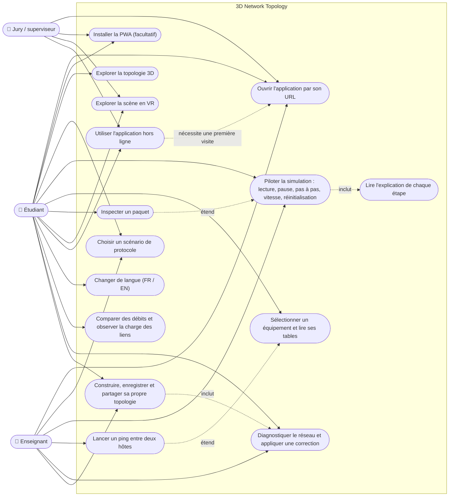

# Diagramme de cas d'utilisation

## Acteurs

| Acteur | Ce qu'il cherche |
| --- | --- |
| **Étudiant** (acteur principal) | comprendre un protocole en le regardant fonctionner, à son rythme |
| **Enseignant** | montrer un échange en cours ou en TD, lancer un ping entre deux hôtes choisis |
| **Jury / superviseur** | vérifier la démonstration : accès par URL, installation, VR émulée, hors ligne |

## Cas d'utilisation et fonctionnalités du cahier des charges

| Cas d'utilisation | Fonctionnalité | Précondition | Résultat observable |
| --- | --- | --- | --- |
| Ouvrir l'application par son URL | F07 | navigateur récent, connexion | la topologie s'affiche, sans installation |
| Installer la PWA | F07 | Chrome/Edge, HTTPS | icône sur l'appareil ; un refus n'empêche rien |
| Explorer la topologie 3D | F01 | — | rotation, zoom, déplacement à la souris ou au doigt |
| Choisir un scénario | F03, F04 | — | nouvelle topologie, explications du scénario |
| Piloter la simulation | F06 | scénario chargé | les paquets avancent, se figent ou repartent |
| Lire l'explication de chaque étape | F02 | simulation lancée | texte mis à jour à chaque message |
| Sélectionner un équipement | F01, F05 | — | nom, IP, MAC, cache ARP, table MAC ou de routage |
| Lancer un ping entre deux hôtes | F03 | deux hôtes sélectionnés | ARP puis ICMP entre ces deux hôtes |
| Inspecter un paquet | F05 | un paquet affiché | MAC, IP, TTL, ports, indicateurs, contenu |
| Explorer la scène en VR | F08 | casque ou Immersive Web Emulator | session immersive, panneau 3D ; sinon mode classique |
| Utiliser l'application hors ligne | F07 | une première visite connectée | rechargement sans réseau |
| Comparer des débits | superviseur | scénario « Débit » | durée et débit utile de chaque transfert, câbles colorés selon la charge, fiche technique |
| Diagnostiquer le réseau | superviseur | scénario chargé | liste des problèmes avec cause et conseil ; correction en un clic |
| Construire sa topologie | superviseur | onglet Construire | réseau ajouté, câblé, adressé, joué ; enregistré, exporté ou importé |
