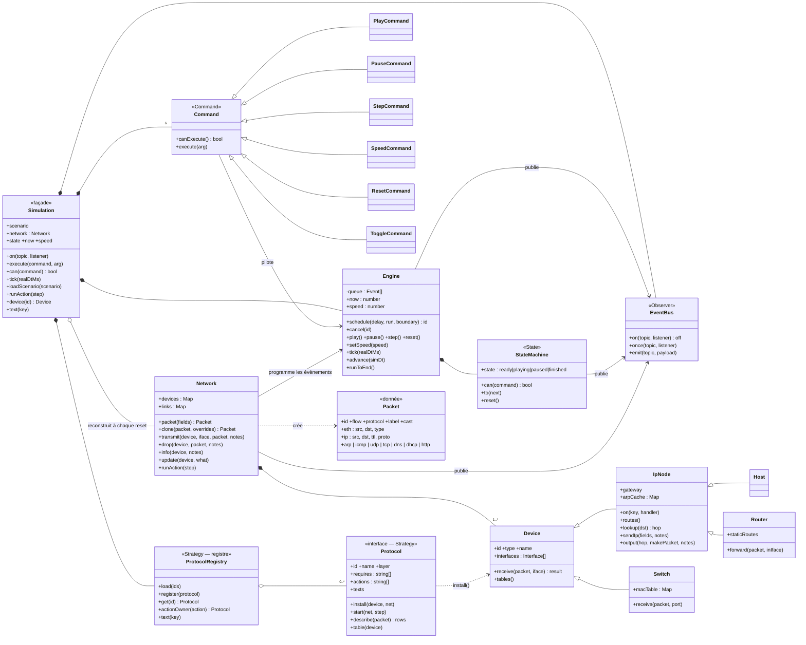

# Diagramme de classes

Le diagramme couvre la simulation (`simulation.js`, `src/sim/`), cœur métier de l'application. Le rendu et
l'interface n'ont pas de classes : ce sont des modules de fonctions abonnés au bus.

Protocoles livrés (chacun réalise `Protocol`) : `arp`, `icmp`, `udp`, `dns`, `dhcp`, `tcp`, `http`, `ipv6`.

## Les cinq patrons de conception du cahier des charges

| Patron | Où | Pourquoi |
| --- | --- | --- |
| **Observer** | `EventBus` (`src/sim/eventBus.js`) | la simulation publie ; l'interface, la 3D et la VR s'abonnent. Aucune partie n'appelle directement une autre : chacune se développe et se teste seule. |
| **Command** | `src/sim/commands.js` | lecture, pause, pas à pas, vitesse, réinitialisation sont des objets `canExecute()` / `execute()`. Les boutons HTML, le clavier et le panneau VR partagent la même logique. |
| **Strategy** | `ProtocolRegistry` + un fichier par protocole | la logique de traitement est choisie d'après l'identifiant du protocole. Ajouter un protocole = ajouter un fichier, sans toucher au moteur. |
| **Factory** | `loadDeviceTypes()` (`src/sim/network.js`) et `createDeviceFactory()` (`src/render/factory.js`) | à partir de l'objet JSON d'un équipement, créer le bon comportement (hôte, routeur, switch) et le bon modèle 3D. |
| **State** | `StateMachine` (`src/sim/state.js`) | prêt, lecture, pause, terminé : les transitions interdites sont refusées et l'interface sait quels boutons activer. |

## Choix de conception

- **`Network` ne connaît aucun protocole.** Il transporte des trames d'un bout à l'autre d'un câble. Les protocoles
  se branchent sur les équipements (`device.on('ip:ICMP', fn)`), ce qui évite toute dépendance du moteur vers eux.
- **`IpNode` factorise** ce que l'hôte et le routeur ont en commun (table de routage, émission IP, cache ARP) ;
  le routeur n'ajoute que le relais (`forward`) et les routes statiques.
- **Le réseau est reconstruit à chaque réinitialisation** : tables et caches repartent vides, sans code de nettoyage à maintenir.
- **`Packet` est une simple donnée**, validée à la création (`createPacket`). Un paquet relayé est une copie (`clone`)
  qui garde le même `flow` : on peut suivre un message de saut en saut.
