# Diagramme de déploiement

```mermaid
flowchart LR
  subgraph dev["Postes des développeurs"]
    git["Dépôt Git local<br/>branche feature/…"]
  end

  subgraph gh["GitHub"]
    repo["Dépôt<br/>branche main protégée"]
    ci["GitHub Actions<br/>1. npm test<br/>2. liste de cache<br/>3. assemblage du site"]
    pages["GitHub Pages<br/>fichiers statiques — HTTPS"]
    repo -- "push / pull request" --> ci
    ci -- "si main et tests OK" --> pages
  end

  subgraph client["Appareil de l'utilisateur (PC ou smartphone)"]
    subgraph nav["Navigateur (Chrome)"]
      html["Interface HTML<br/>index.html, styles.css, src/ui/"]
      three["Three.js — WebGPU<br/>(secours WebGL 2)<br/>src/render/"]
      sim["Simulation<br/>simulation.js, src/sim/"]
      xr["WebXR Device API<br/>src/xr/"]
      sw["Service Worker<br/>sw.js + Cache Storage"]
      html <--> sim
      sim --> three
      three <--> xr
    end
    casque["Casque XR<br/>ou Immersive Web Emulator"]
    xr <--> casque
  end

  git -- "git push" --> repo
  pages -- "HTTPS — première visite" --> sw
  sw -- "sert les fichiers,<br/>même hors ligne" --> html
```

## Nœuds

| Nœud | Rôle | Technologie |
| --- | --- | --- |
| Poste du développeur | écrire, tester (`npm test`), essayer (`npm start`) | Git, Node.js ≥ 20 |
| GitHub — dépôt | source de vérité ; `main` est protégée et toujours exécutable | Git, CODEOWNERS |
| GitHub Actions | tests à chaque push ; déploiement automatique de `main` | `.github/workflows/ci.yml` |
| GitHub Pages | hébergement statique en HTTPS, sous `https://<compte>.github.io/<depot>/` | aucun serveur applicatif |
| Navigateur | exécute toute l'application | modules ES, WebGPU (ou WebGL 2), WebXR, Service Worker |
| Casque ou émulateur | affichage immersif | WebXR `immersive-vr` |

## Contraintes prises en compte

- **Aucun backend** : le site est un ensemble de fichiers statiques. Les scénarios sont des fichiers JSON chargés par `fetch`.
- **HTTPS obligatoire** pour le Service Worker et WebXR : fourni par GitHub Pages (`localhost` suffit en développement).
- **Sous-chemin du dépôt** : tous les chemins de l'application sont relatifs (`scenarios/…`, `sw.js`, `./` dans le manifest),
  elle fonctionne donc aussi bien sous `/<depot>/` qu'à la racine.
- **Aucune ressource externe** : Three.js est copié dans `vendor/three/`, les polices sont celles du système.
  Après la première visite, tout vient du cache.
