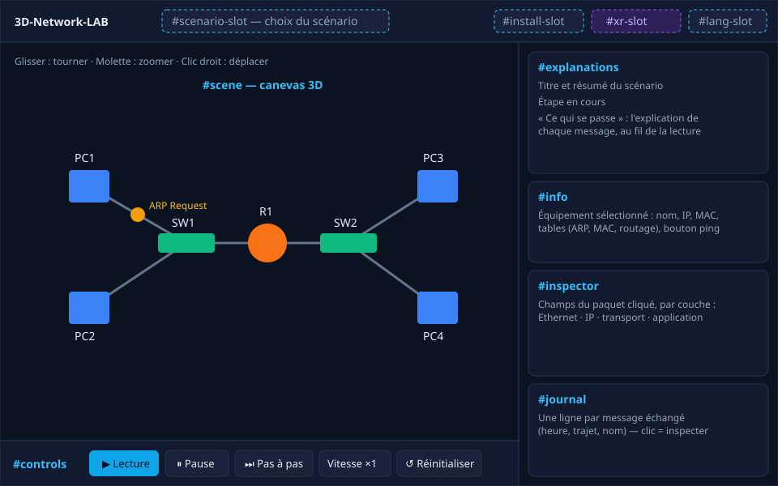

# Maquette de l'interface

## Principe

L'écran est partagé en **zones réservées**. Chaque zone a un identifiant dans `index.html` et un
seul module qui la remplit : deux membres ne travaillent donc jamais dans la même zone.

| Zone | Contenu | Rempli par | Depuis |
| --- | --- | --- | --- |
| `#scene` | canevas 3D : équipements, câbles, paquets | `src/render/` (Aziz) | S1 |
| pastille « WebGPU » (bas droite de `#scene`) | ouvre le panneau « Technologies » : ce que l'appareil fournit, mesuré en direct | `src/ui/techPanel.mjs`, `src/ui/techReport.mjs` | S7 |
| `#controls` | Lecture, Pause, Pas à pas, Vitesse, Réinitialiser, état, horloge simulée | `src/ui/controls.mjs` | S2 |
| `#info` | équipement sélectionné : nom, IP, MAC, tables, bouton de ping | `src/ui/infoPanel.mjs` | S2 |
| `#explanations` | scénario, étape en cours, explication de chaque message | `src/ui/explanations.mjs` | S3 |
| `#inspector` | champs du paquet sélectionné, couche par couche | `src/ui/inspector.mjs` | S3 |
| `#journal` | liste des messages échangés et légende des couleurs | `src/ui/journal.mjs` | S3 |
| `#scenario-slot` | titre du scénario, puis liste de choix | `src/ui/scenarioPicker.mjs` | S4 |
| `#install-slot` | bouton « Installer » (installation en un clic, ou explication du geste selon le navigateur), pastille « Hors ligne » | `src/ui/install.mjs` | S5 |
| `#xr-slot` | état de WebXR, puis bouton « Entrer en VR » | `src/xr/` (Ayoub) | S1 / S4 |
| `#lang-slot` | bouton FR / EN | `src/ui/i18n.mjs` | S1 |
| onglets (`nav.tabs`) | Lecture · Diagnostic (· Construire en S7) en haut de la colonne de droite | `src/ui/tabs.mjs` | S6 |
| `#diagnostic` | constats du diagnostic, boutons Montrer / Corriger | `src/ui/diagnosticPanel.mjs` | S6 |
| `#editor` | éditeur de topologie : ajout, câblage, réglages, échanges, sauvegardes | `src/ui/editorPanel.mjs` | S7 |

Une zone vide ne s'affiche pas (règle CSS `.panel:empty`) : la page reste propre tant que
le module correspondant n'est pas livré.

## Choix d'ergonomie

- **La scène occupe la plus grande partie de l'écran** ; les commandes sont juste dessous, là où
  le regard revient après chaque action.
- **Les panneaux suivent l'ordre du raisonnement** : comprendre (explications) → regarder un
  équipement → regarder un paquet → relire l'historique.
- **Téléphone** (largeur < 860 px) : la scène passe en haut, les panneaux défilent dessous ; les
  boutons de commande ne gardent que leur icône et mesurent au moins 44 px.
- **Couleurs** : un thème sombre unique, assorti au fond de la scène ; les couleurs vives sont
  réservées aux paquets (une par protocole) pour qu'ils ressortent.
- **Accessibilité** : tous les boutons sont de vrais `<button>` utilisables au clavier
  (Espace = lecture/pause, → = pas à pas, R = réinitialiser), avec infobulle et `aria-label`.
- **Deux langues** : français par défaut, anglais par le bouton en haut à droite.
