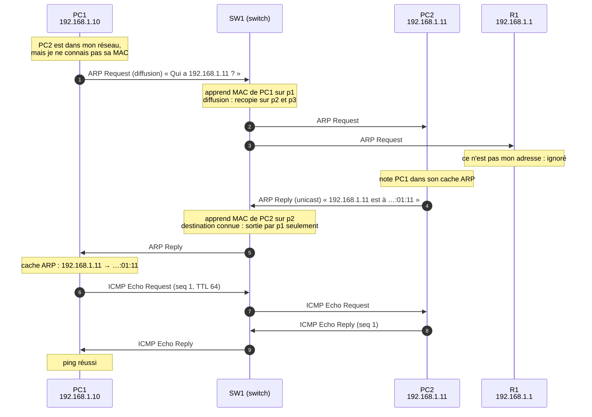
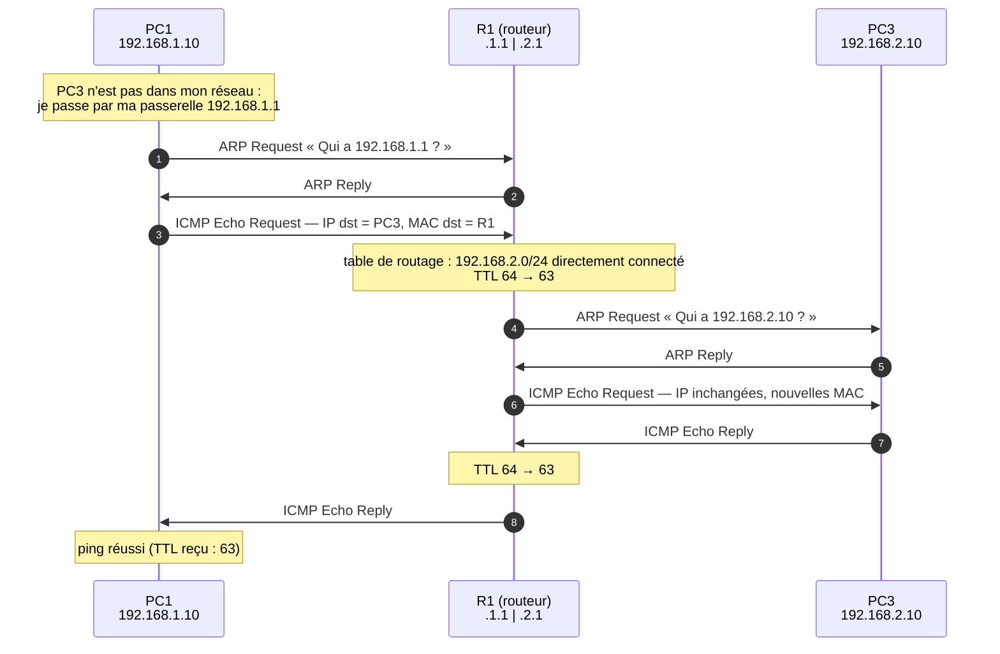

# Diagramme de séquence du ping

Scénario `scenarios/ping.json`, étape 1 : **PC1 (192.168.1.10) envoie un ping à PC2 (192.168.1.11)**,
dans le même réseau, caches ARP et table MAC vides au départ.

Ce qu'il faut retenir :

1. **ARP précède toujours le premier paquet IP** vers une adresse dont la MAC est inconnue.
2. La requête ARP est une **diffusion** (tout le réseau local la reçoit) ; la réponse est **unicast**.
3. Le switch **apprend** les adresses MAC à chaque trame reçue, puis cesse d'inonder ses ports.

## Étape 2 : ping vers un autre réseau (PC1 → PC3, à travers R1)

Les switches SW1 et SW2, transparents pour IP, sont omis de ce second diagramme.

4. Pour sortir de son réseau, PC1 cherche la MAC **de la passerelle**, pas celle de PC3.
5. À chaque routeur, les **adresses MAC changent**, les **adresses IP restent**, le **TTL diminue de 1**.

## Correspondance avec le code

| Message du diagramme | Code | Explication affichée (clé) |
| --- | --- | --- |
| choix remise directe / passerelle | `IpNode.sendIp()` — `src/sim/devices/host.js` | `host.direct`, `host.viaGateway` |
| ARP Request / Reply | `resolve()`, `receive()` — `src/sim/protocols/arp.js` | `arp.request`, `arp.reply`, `arp.cacheUpdate` |
| apprentissage et inondation | `Switch.receive()` — `src/sim/devices/switch.js` | `switch.learn`, `switch.flood.broadcast`, `switch.forward` |
| ICMP Echo Request / Reply | `sendEcho()`, `receive()` — `src/sim/protocols/icmp.js` | `icmp.echoRequest`, `icmp.echoReply`, `icmp.success` |
| relais et TTL | `Router.forward()` — `src/sim/devices/router.js` | `router.lookup`, `router.ttl`, `router.forward` |

La suite exacte des messages est figée dans `tests/golden/ping.txt` et vérifiée par `tests/regression.test.js`.
