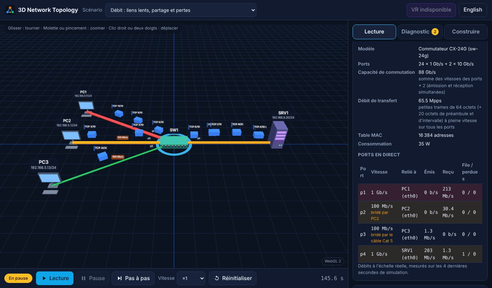

# Débit et bande passante

> Demande du superviseur (S5). Code : `src/sim/catalog.mjs`, `src/sim/traffic.mjs`,
> `src/sim/network.mjs` (méthode `transmit`), `src/sim/protocols/tcp.mjs` (transferts),
> `src/render/linkLoad.mjs` (couleurs des câbles), `src/ui/datasheet.mjs` (fiche technique).



## 1. Pourquoi

Jusqu'en S4, tous les liens se valaient : un paquet traversait n'importe quel câble en une
seconde. Or le débit est au cœur des réseaux réels : une vieille carte à 100 Mb/s ralentit
tout un poste, un câble Cat 5 bride un lien Gigabit, un serveur partagé par plusieurs postes
devient un goulot. Le simulateur montre maintenant tout cela.

## 2. La vitesse d'un lien

Chaque équipement a un **modèle** (catalogue fictif, `src/sim/catalog.mjs`) qui fixe la
vitesse de ses ports ; chaque câble a un **type** (Cat 5, 5e, 6, 6a, fibre). Comme
l'auto-négociation Ethernet, le lien prend **la plus petite** des trois vitesses :

```
vitesse du lien = min(port A, port B, câble)
```

Le Cat 6 ne tient 10 Gb/s que jusqu'à 55 m ; au-delà il redescend à 1 Gb/s. Un scénario
peut aussi imposer la vitesse d'une interface (`"speed": 100`).

La fiche technique d'un modèle est **calculée**, comme sur une fiche constructeur :

| Caractéristique | Calcul |
|---|---|
| Capacité de commutation | somme des vitesses des ports × 2 (full duplex) |
| Débit de transfert (Mpps) | somme des vitesses / ((64 + 20) octets × 8) |

## 3. Le temps d'une trame

Une trame de 1 518 octets traverse un lien Gigabit en 12 µs : invisible. Le simulateur passe
au **ralenti** : 1 µs réelle = 10 ms à l'écran (`SLOW_MOTION = 10 000`).

```
taille (octets)  = en-têtes réels (Ethernet 18, IP 20, TCP 20, UDP 8…) + données, entre 64 et 1 518
temps d'émission = taille × 8 / vitesse            (puis × SLOW_MOTION)
départ           = max(maintenant + traitement, fin de la trame précédente sur ce port)
arrivée          = départ + temps d'émission + traversée du câble (1 s)
```

Exemples : une grande trame occupe un port Gigabit 0,12 s à l'écran, un port à 100 Mb/s
1,21 s. Entre deux trames d'un même port, 0,2 s d'écart permet de les distinguer à l'œil.

## 4. Files d'attente, charge et pertes

- Un port émet ses trames **une par une** : celles qui arrivent pendant une émission
  attendent dans sa **file**. La fiche « Ports en direct » montre la file et le maximum atteint.
- `TrafficMeter` (`src/sim/traffic.mjs`) mesure, sur les 4 dernières secondes simulées, le
  **taux d'utilisation** de chaque lien (temps occupé / temps écoulé) et les **débits** de
  chaque port, convertis à l'échelle réelle.
- Au-delà de 50 % d'utilisation, une étiquette « Charge 72 % » apparaît au milieu du câble :
  **orange**, puis **rouge** au-delà de 80 %. La gaine garde la couleur de son type de câble
  (Cat 5 gris, Cat 6 bleu, fibre turquoise…) ; pendant qu'un paquet passe, une lueur légère de
  la couleur de son protocole court le long du câble.
  Chaque câble porte une étiquette avec son type et la vitesse réelle du lien (« Cat 6 · 1 Gb/s ») ;
  quand une carte ou le câble bride le lien, elle est orange et dit lequel (« Cat 5 · 100 Mb/s —
  bridé par le câble ») et reste toujours visible. Sur le switch, le voyant de lien d'un port à
  100 Mb/s est orange.
- Une étape peut faire **perdre** des segments TCP (`"lose": [2, 9]`) : la trame s'arrête sur
  le câble, sa carte devient rouge (« ✕ perdu »), puis tombe et s'efface.

## 5. TCP : transferts, fenêtre et retransmissions

Avec `"size"`, l'action `tcp` envoie un fichier découpé en segments de 1 460 octets (MSS) :

- **fenêtre glissante** : `window` segments partent sans attendre d'accusé ;
- **acquittement cumulatif** : un ACK acquitte tout ce qui précède ;
- un segment arrivé **dans le désordre** est mis de côté, et le récepteur répète le même ACK
  (**ACK dupliqué**) ;
- au **3ᵉ ACK dupliqué**, l'émetteur renvoie aussitôt le segment manquant (**retransmission
  rapide**) ;
- si rien n'arrive, le **délai RTO** (4 allers-retours mesurés, 8 s au moins) déclenche la
  retransmission ;
- le bilan donne la durée et le **débit utile** à l'échelle réelle.

Pas de contrôle de congestion : la fenêtre reste fixe pour que les effets soient lisibles.

## 6. Le scénario « Débit »

1. PC1 (Gigabit) envoie 14 600 octets ; 2. PC2 (carte 100 Mb/s) envoie la même chose,
bien plus lentement ; 3. pertes : retransmission rapide puis délai RTO ; 4. trois postes
envoient ensemble et le lien du serveur se charge.

Contrôle : `tests/debit.test.mjs` (vitesses, temps d'émission, fenêtre, pertes, partage).
