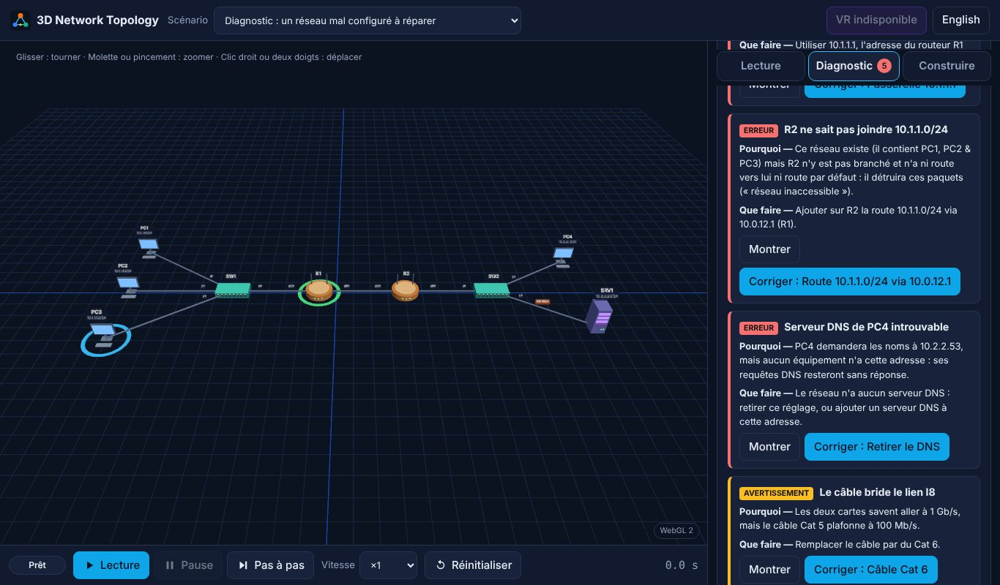

# Diagnostic du réseau et recommandations

> Demande du superviseur (S6). Code : `src/sim/diagnostic.js` (règles, corrections),
> `src/ui/diagnosticPanel.js` (onglet), `src/xr/vrInfoPanel.js` (panneau VR).
> Tests : `tests/diagnostic.test.js`.

## Principe

`diagnose(scénario, { traffic })` lit une topologie et retourne des **constats**. Chacun dit :

| Champ | Contenu |
|---|---|
| `severity` | `error` (la communication échoue), `warning` (fonctionne mal), `info` (à savoir) |
| `title` / `cause` / `advice` | quoi, pourquoi, que faire — en français et en anglais |
| `devices`, `links` | ce qu'il faut surligner dans la scène (« Montrer ») |
| `fix` | correction automatique sûre, appliquée par `applyFix()` sur une **copie** |

Les règles sont de simples fonctions : on en ajoute une sans toucher aux autres.

## Règles

| Thème | Règle | Gravité | Correction en un clic |
|---|---|---|---|
| Adressage | adresse IP en double | erreur | adresse libre du même réseau |
| | adresse MAC en double | erreur | MAC libre (préfixe 02) |
| | poste sans adresse (sans DHCP) | erreur | adresse libre + passerelle |
| | poste en attente du DHCP | remarque | — |
| | deux réseaux IP sur le même switch | avertissement | adresse dans le réseau majoritaire |
| Passerelle | hors du réseau du poste | erreur | adresse du routeur du réseau |
| | adresse qui n'est pas un routeur | erreur | idem |
| | absente alors qu'il existe d'autres réseaux | avertissement | idem |
| Routage | routeur sans chemin vers un réseau qui existe | erreur | route via le voisin le plus proche (parcours en largeur) |
| | prochain saut hors des réseaux du routeur | erreur | — |
| Câblage | équipement isolé | avertissement | — |
| | boucle entre switchs (tempête de diffusion) | erreur | retirer le câble qui ferme la boucle |
| | câble plus long que sa portée | erreur | fibre |
| | port absent du modèle | avertissement | premier port libre |
| Services | serveur DNS introuvable | erreur | adresse du serveur DNS, ou retirer le réglage |
| Performances | câble qui bride le lien | avertissement | câble Cat 6 / 6a |
| | carte qui bride le lien | remarque | modèle plus rapide |
| | lien du serveur goulot | remarque | — |
| | lien saturé (> 80 %) pendant la lecture | avertissement | — |
| | trames perdues | remarque | — |

## Interface

- Onglet **Diagnostic** : résumé, cartes par constat, boutons « Montrer » et « Corriger »,
  « Tout corriger » (une correction peut en révéler une autre : on recommence tant qu'il y
  en a), « Revenir au scénario d'origine ».
- Le badge de l'onglet affiche le nombre d'erreurs et d'avertissements.
- Pendant la lecture, le diagnostic est réévalué chaque seconde (règles de trafic).
- En VR, le panneau de droite a un onglet Diagnostic avec un bouton « Corriger ».

## Le scénario « Diagnostic »

Un réseau à deux routeurs avec quatre erreurs (adresse en double, passerelle hors réseau,
route manquante sur R2, DNS introuvable) et un câble Cat 5. Les pings échouent ; une fois
tout corrigé, ils réussissent tous (vérifié par `tests/diagnostic.test.js`).
