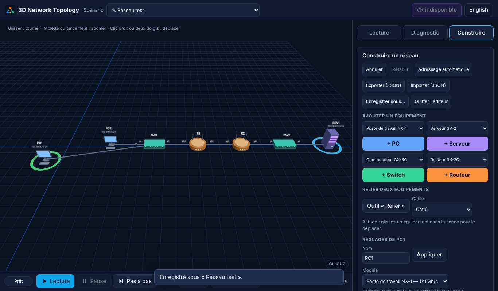

# Éditeur de topologie

> Demande du superviseur (S7). Code : `src/sim/builder.js` (opérations pures),
> `src/ui/editorPanel.js` (onglet Construire), `src/render/dragControls.js` (glisser).
> Tests : `tests/builder.test.js`.

## Utilisation

1. Onglet **Construire** → « Nouveau réseau vide » (ou « Modifier le scénario affiché »). Dans cet onglet, chaque
   câble affiche son type et la vitesse réelle du lien (« Cat 6 · 1 Gb/s ») : on voit tout de suite l'effet d'un
   changement de câble ou d'équipement.
2. **Ajouter** : choisir un modèle sous PC, Serveur, Switch ou Routeur puis cliquer « + ».
   L'équipement se place à côté de celui qui est sélectionné.
3. **Déplacer** : glisser un équipement dans la scène (souris ou doigt).
4. **Relier** : activer l'outil « Relier », choisir le câble, cliquer deux équipements. Le
   câble prend le premier port libre de chacun. Sous la liste « Câble », la fiche du câble choisi
   donne sa vitesse, sa portée et son usage ; dans le laboratoire, un clic sur un rouleau de
   l'étagère choisit aussi le câble.
5. **Régler** : cliquer un équipement. Nom, modèle, adresses (bouton « Proposer »),
   passerelle, DNS, rôles (DHCP, DNS, web, écoute TCP), routes statiques d'un routeur (avec
   proposition des routes manquantes), câbles et suppression.
6. **Adressage automatique** : un réseau par domaine de diffusion (192.168.N.0/24, 10.0.0.x/30
   entre deux routeurs), .1 pour les routeurs, .10 et suivantes pour les postes, passerelles,
   puis routes statiques jusqu'à ce que le diagnostic n'en trouve plus aucune qui manque.
7. **Jouer** : choisir l'échange (ping, transfert TCP, UDP, DNS, page web, DHCP), la source et
   la destination, puis « Lancer » — ou « Ajouter aux étapes » pour le rejouer avec Lecture.

L'onglet Diagnostic suit le brouillon en permanence ; ses corrections s'ajoutent à
l'historique de l'éditeur.

## Enregistrer

- Le brouillon est **enregistré automatiquement** dans le navigateur (`localStorage`) et
  proposé au retour (« Reprendre le brouillon »).
- « Enregistrer sous… » garde plusieurs réseaux nommés (« Mes réseaux enregistrés »).
- « Exporter (JSON) » télécharge un fichier au format des scénarios ; « Importer (JSON) »
  le recharge (le fichier est validé et les erreurs sont listées).
- « Annuler » / « Rétablir » parcourent l'historique (60 versions).

Si le navigateur refuse le stockage (navigation privée), un message invite à exporter.

## Conception

Chaque opération de `builder.js` reçoit un brouillon et en **retourne une copie** modifiée :
l'historique n'est qu'une liste de versions, et tout se teste sans navigateur. Une opération
impossible lève une `BuildError` dont le message existe en français et en anglais. Après
chaque modification, l'éditeur recharge le brouillon dans la simulation : la scène, le
diagnostic et la fiche technique suivent sans code supplémentaire.

Garde-fou : une boucle de câbles entre switchs ferait tourner les diffusions sans fin. Le
switch arrête une trame qui a déjà traversé plus de 2 × (nombre de switchs) + 2 switchs et
explique la « tempête de diffusion ».
