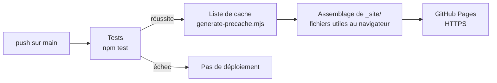

# Lancement en local et déploiement

## 1. Lancer l'application sur son poste

Prérequis : [Git](https://git-scm.com) et [Node.js](https://nodejs.org) 20 ou plus récent. Il n'y a **aucune dépendance à installer** (pas de `npm install`).

```bash
git clone https://github.com/<compte>/<depot>.git
cd <depot>
npm start
```

Puis ouvrir **http://localhost:8080** dans Chrome. `Ctrl+C` arrête le serveur. Autre port : `PORT=3000 npm start`
(PowerShell : `$env:PORT=3000; npm start`).

`npm start` fait deux choses : il génère `precache-manifest.js` (la liste des fichiers à mettre en cache), puis lance
`tools/serve.mjs`, un petit serveur de fichiers statiques.

> **Pourquoi un serveur ?** Ouvrir `index.html` par un double-clic (`file://…`) ne fonctionne pas : le navigateur
> refuse de charger les modules JavaScript et les scénarios JSON depuis le disque. `localhost` est en revanche un
> « contexte sécurisé » : le Service Worker et WebXR y fonctionnent sans HTTPS.

### Commandes utiles

| Commande | Effet |
| --- | --- |
| `npm start` | serveur local sur le port 8080 |
| `npm test` | tous les tests automatiques (`node --test`) |
| `node --test tests/tcp.test.js` | un seul fichier de tests |
| `npm run precache` | régénère `precache-manifest.js` |
| `npm run models` | régénère les modèles GLB de `assets/models/` |
| `npm run icons` | régénère les icônes PNG de `assets/icons/` |

### En développement, attention au cache

Sur `localhost`, le Service Worker interroge toujours le réseau en premier : un rechargement suffit pour voir une
modification. En cas de doute : outils de développement de Chrome → **Application → Service workers → Unregister**,
puis **Storage → Clear site data**.

### Tester la VR sur PC

1. Installer l'extension Chrome **Immersive Web Emulator** (Meta).
2. Recharger la page : le bouton « Entrer en VR » devient actif.
3. Outils de développement → onglet **WebXR** : déplacer le casque et les manettes, appuyer sur la gâchette.

## 2. Déploiement sur GitHub Pages

Le déploiement est **automatique** : chaque fusion dans `main` lance `.github/workflows/ci.yml`.



Sur une pull request, seuls les tests sont lancés.

### Réglages à faire une seule fois dans le dépôt GitHub

1. Le dépôt doit être **public** : avec un compte gratuit, GitHub Pages et la protection de branche ne sont offerts qu'aux dépôts publics.
   Puis **Settings → Pages → Build and deployment → Source : « GitHub Actions »**.
2. **Settings → Branches → Add branch ruleset** (ou *Add rule*) pour `main` :
   - *Require a pull request before merging*, avec 1 approbation (option : *Require review from Code Owners*) ;
   - *Require status checks to pass* → choisir le contrôle **Tests** ;
   - interdire les *force pushes*.
3. Dans `.github/CODEOWNERS`, remplacer les quatre identifiants `@GITHUB-…` par les vrais noms d'utilisateur.

Après le premier déploiement, l'adresse du site s'affiche dans **Settings → Pages** et dans l'onglet **Actions** :
`https://<compte>.github.io/<depot>/`. La reporter dans le `README.md`.

### Ce qui est publié

Seulement ce dont le navigateur a besoin : `index.html`, `styles.css`, `main.js`, `simulation.js`, `manifest.json`,
`sw.js`, `precache-manifest.js`, `src/`, `scenarios/`, `assets/`, `vendor/`. Les tests, la documentation et les outils restent dans le dépôt.

### Vérifier un déploiement

1. Onglet **Actions** : le dernier « CI » est vert.
2. Ouvrir l'URL HTTPS ; dans la console, aucune erreur.
3. Outils de développement → **Application → Service workers** : `sw.js` est « activated and is running ».
4. **Application → Cache storage** : un cache `3dnt-<version>` contient tous les fichiers.
5. **Network → Offline**, recharger : l'application s'affiche, la pastille « Hors ligne » apparaît.

### Vérification HTTPS automatique

Après chaque déploiement, et **chaque lundi** (planification de `ci.yml`), le travail « Vérification HTTPS / TLS »
lance `node tools/verify-https.mjs https://<compte>.github.io/<dépôt>/`. Il contrôle :

| Contrôle | Bloquant si… |
| --- | --- |
| réponse HTTPS (code 200) | le site ne répond pas (8 essais espacés de 15 s, le temps que Pages publie) |
| certificat vérifié (chaîne de confiance, nom d'hôte) | non vérifié |
| validité du certificat | expiré (avertissement s'il expire dans moins de 14 jours) |
| version de TLS, suite de chiffrement, échange de clés | version antérieure à TLS 1.2 |
| TLS 1.2 accepté, TLS 1.0/1.1 refusés | TLS 1.0 ou 1.1 encore acceptés |
| redirection HTTP → HTTPS, en-tête HSTS | (avertissements seulement) |

Le résultat s'affiche en tableau dans la page de l'exécution GitHub Actions. On peut lancer la même commande sur son
poste. Les jugements sont testés sans réseau (`tests/verify-https.test.js`).

### Mise à jour chez les utilisateurs

La `version` de `precache-manifest.js` est une empreinte du contenu des fichiers. Dès qu'un fichier change, le
Service Worker déployé est différent : le navigateur l'installe en arrière-plan, crée un nouveau cache et supprime
l'ancien. La nouvelle version s'affiche **au rechargement suivant**.

## 3. Publier une version

```bash
git checkout main && git pull
npm test
git tag -a v1.0 -m "Version 1.0"
git push origin v1.0
```

L'étiquette déclenche `.github/workflows/release.yml` : tests, puis création de la *release* GitHub avec une archive
`3d-network-topology-v1.0.zip` du site. Cette archive sert aussi de **plan B pour la soutenance** : la décompresser,
puis `npx serve` ou `python -m http.server 8080` dans le dossier, et ouvrir `http://localhost:8080`.

## 4. Dépannage

| Symptôme | Cause probable | Solution |
| --- | --- | --- |
| Page blanche, erreur CORS dans la console | fichier ouvert en `file://` | passer par `npm start` |
| `EADDRINUSE` au lancement | le port 8080 est occupé | `PORT=3000 npm start` |
| Une modification n'apparaît pas | ancien Service Worker | *Unregister* + *Clear site data* (voir plus haut) |
| 404 sur GitHub Pages | source Pages mal réglée, ou premier déploiement en cours | vérifier Settings → Pages et l'onglet Actions |
| Bouton VR grisé | pas de casque ni d'émulateur, ou page servie en HTTP hors localhost | installer l'émulateur ; utiliser l'URL HTTPS |
| Le déploiement ne part pas | tests en échec | lire le journal du job « Tests » |
