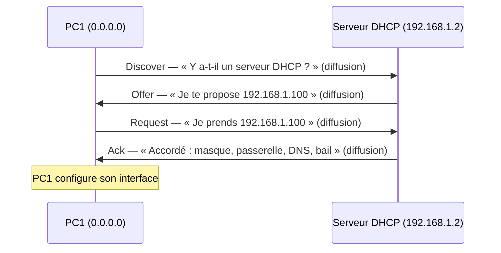

# DHCP — Dynamic Host Configuration Protocol

**Rôle.** Un poste qui démarre sans adresse obtient automatiquement son adresse IP, son masque, sa passerelle et son serveur DNS.

| | |
| --- | --- |
| Code | `src/sim/protocols/dhcp.js` |
| Tests | `tests/dhcp.test.js` |
| Scénario | `scenarios/dhcp.json` |
| Couche | application — transporté par UDP, ports 67 (serveur) et 68 (client) |
| Action de scénario | `{ "action": "dhcp", "from": "pc1" }` |

## Les quatre messages (« DORA »)

| Message | Explication (clé) | À remarquer dans l'inspecteur |
| --- | --- | --- |
| Discover | `dhcp.discover` | IP source `0.0.0.0`, IP destination `255.255.255.255` : le client n'a encore aucune adresse |
| Offer | `dhcp.offer` | l'adresse proposée, tirée de la plage du serveur |
| Request | `dhcp.request` | toujours diffusé : il informe aussi d'éventuels autres serveurs du choix du client |
| Ack | `dhcp.ack`, puis `dhcp.bound` | masque, passerelle, DNS, durée du bail |

Les autres machines du réseau reçoivent ces diffusions et les ignorent : elles ne sont ni client en attente
ni serveur. L'étiquette de PC1 dans la scène passe de « — (IP ?) » à sa nouvelle adresse dès l'Ack.

**Étape 2 du scénario** : PC1 fait un ping vers la passerelle reçue (192.168.1.1) — preuve que la configuration fonctionne.

Configuration du serveur dans le scénario :
`"services": { "dhcp": { "start": "192.168.1.100", "end": "192.168.1.110", "prefix": 24, "gateway": "192.168.1.1", "dns": "192.168.1.2", "lease": 3600 } }`.
Si la plage est épuisée, le serveur ne répond pas (`dhcp.poolEmpty`).

## Simplifications pédagogiques

- les quatre messages sont diffusés ; un vrai serveur peut répondre en unicast selon un indicateur du client ;
- un seul serveur, pas de relais DHCP entre réseaux ;
- pas de renouvellement ni d'expiration du bail ;
- l'identifiant de transaction est dérivé de l'adresse MAC, pour que deux lectures donnent la même trace.
