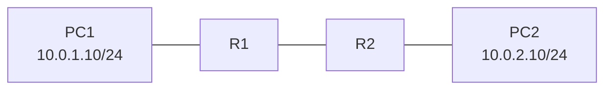

# Routage statique et TTL

**Rôle.** Un routeur relie plusieurs réseaux IP : il reçoit un paquet sur une interface, consulte sa table de routage
et le renvoie par une autre.

| | |
| --- | --- |
| Code | `src/sim/devices/router.js` (et `IpNode` dans `src/sim/devices/host.js`) |
| Tests | `tests/routage.test.js` |
| Scénario | `scenarios/routage.json` |

## La topologie du scénario

| Routeur | Réseaux connectés | Route statique |
| --- | --- | --- |
| R1 | 10.0.1.0/24, 10.0.12.0/30 | 10.0.2.0/24 via 10.0.12.2 |
| R2 | 10.0.12.0/30, 10.0.2.0/24 | 10.0.1.0/24 via 10.0.12.1 |

D'origine, un routeur ne connaît que les réseaux auxquels il est branché. La route statique, écrite dans le scénario
(`"routes": [{ "network", "prefix", "via" }]`), lui dit par quel voisin joindre un réseau distant. **Il en faut une dans
chaque sens**, sinon la réponse ne revient pas.

## Ce que fait le routeur pour chaque paquet (`Router.forward()`)

1. **TTL.** Si le TTL vaut 1, le paquet est détruit et la source est prévenue par ICMP « Time Exceeded » (`router.ttlExpired`).
2. **Recherche de route** : parmi les routes qui contiennent la destination, la plus précise gagne (préfixe le plus long) — `router.lookup`.
   Aucune route : paquet détruit, ICMP « Destination Unreachable » (`router.noRoute`).
3. **TTL − 1** (`router.ttl`).
4. **Nouvelle trame** : les adresses MAC deviennent celles du lien de sortie (après ARP si besoin) ; les adresses IP
   ne changent pas (`router.forward`).

## Les trois étapes du scénario

| Étape | Ce que l'on observe |
| --- | --- |
| 1. Ping à travers deux routeurs | TTL 64 → 63 → 62 à l'aller ; trois résolutions ARP successives, une par lien |
| 2. Paquet parti avec TTL = 1 | R1 le détruit et renvoie « Time Exceeded » : c'est le principe de `traceroute` |
| 3. Destination 172.16.0.1 | R1 n'a aucune route : « Destination Unreachable » |

Sélectionner un routeur affiche sa **table de routage** (réseau, prochain saut, interface) et son cache ARP.

## Simplifications pédagogiques

- pas de protocole de routage dynamique (RIP, OSPF, BGP : extension F09) ;
- pas de fragmentation, pas de redirection ICMP ;
- un hôte n'a qu'une route vers son réseau et une passerelle par défaut.
