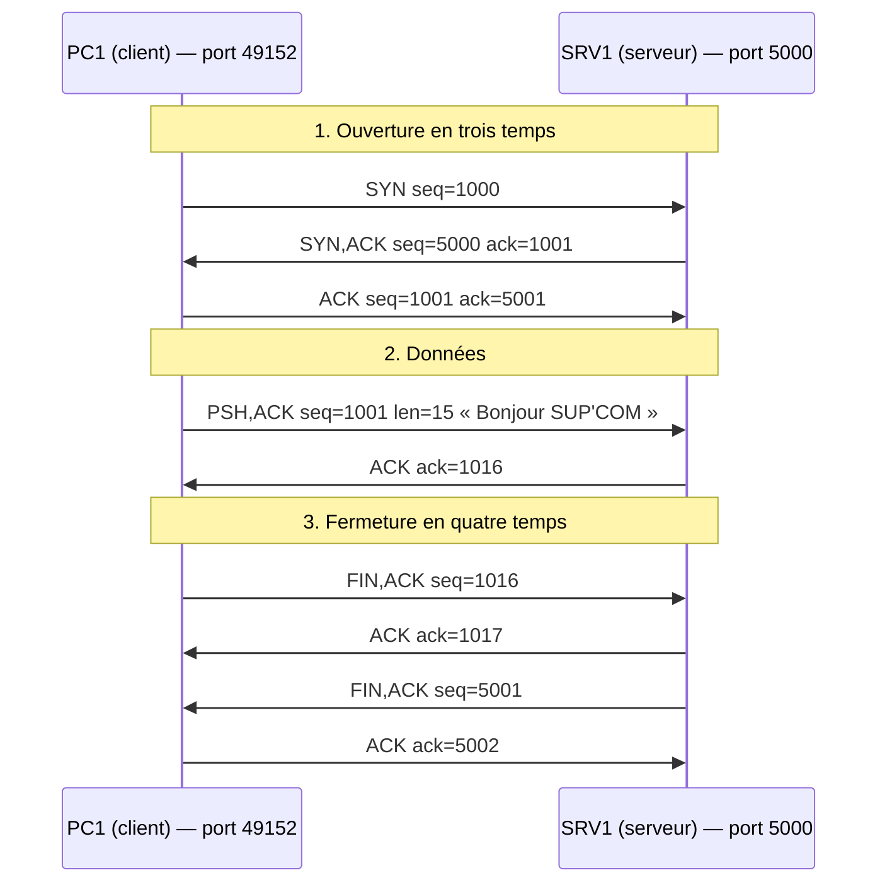

# TCP — Transmission Control Protocol

**Rôle.** Transport fiable « avec connexion » : avant d'échanger des données, les deux machines se mettent d'accord ;
chaque octet envoyé est acquitté.

| | |
| --- | --- |
| Code | `src/sim/protocols/tcp.js` |
| Tests | `tests/tcp.test.js` |
| Scénario | `scenarios/tcp.json` |
| Couche | transport — dépend d'ARP et d'ICMP |
| Action de scénario | `{ "action": "tcp", "from": "pc1", "to": "srv1", "port": 5000, "data": "Bonjour SUP'COM" }` |

## Les trois phases simulées

Règle à vérifier dans l'inspecteur : **l'accusé annonce le prochain octet attendu**. Après 15 octets envoyés à partir
de 1001, l'accusé vaut 1016. SYN et FIN comptent chacun pour un octet.

**Connexion refusée.** La seconde étape du scénario vise le port 6000, où rien n'écoute : le serveur répond `RST,ACK`
(`tcp.rst`) et le client abandonne (`tcp.refused`). À comparer avec UDP, où c'est ICMP qui signale le port fermé.

Le panneau d'infos d'un hôte affiche la table « Connexions TCP » avec l'état de chaque connexion
(`SYN_SENT`, `ESTABLISHED`, `FIN_WAIT_1`, `CLOSE_WAIT`…) : on la voit évoluer en avançant pas à pas.

## Simplifications pédagogiques

- numéros de séquence initiaux **fixes** (1000 côté client, 5000 côté serveur) pour que les calculs se suivent de tête ;
  un vrai système les tire au hasard, pour des raisons de sécurité ;
- ni perte, ni retransmission, ni fenêtre glissante, ni contrôle de congestion ;
- l'application du client n'émet ses données qu'une fois l'ouverture terminée des deux côtés, et le serveur n'envoie son FIN
  qu'après son ACK : chaque segment est ainsi visible séparément (un vrai système en regroupe souvent deux).

## Fonctions offertes aux protocoles d'application

`tcp.connect()`, `tcp.listen()`, `tcp.send()`, `tcp.close()` — utilisées par HTTP.
